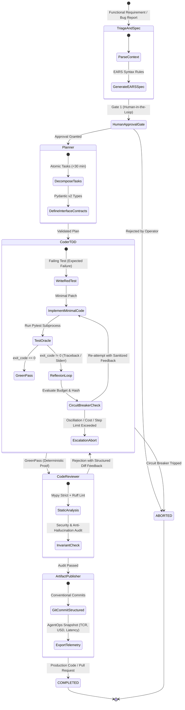

<div align="center">

# 🏭 Autonomous Software Factory
### Closed-Loop Autonomous Software Engineering Engine with Typed StateGraphs, Deterministic Pytest Oracles, and Circuit Breakers

[](https://www.python.org/)
[](https://docs.pydantic.dev/)
[](https://www.sqlite.org/wal.html)
[-success.svg?style=flat-square&logo=pytest&logoColor=white)](https://pytest.org/)
[](https://github.com/ronaldreighsrsc/autonomous-software-factory)
[](LICENSE)

<p align="center">
  <strong>Engineered by Ronald Solares Chuquera</strong><br>
  <em>Industrial Civil Engineer (Univ. de Tarapacá, Top 6% · Rank 5/79)</em><br>
  AI Systems Engineering · Multi-Agent Orchestration · Reliability & MLOps
</p>

[Architecture](#-closed-loop-architecture) • [Engineering Foundations](#-engineering-foundations) • [Formal EARS Specification](#-formal-ears-specification) • [CLI Quickstart](#-cli-quickstart) • [AgentOps Telemetry](#-agentops--observability)

---

</div>

## 📌 Executive Summary

In 2026, naive LLM "wrappers" and unconstrained `while True` loops calling generative models represent brittle engineering anti-patterns: they lack transactional state management, diverge into infinite hallucinatory loops with runaway costs, and verbally assert success without compiling code or executing unit tests.

**`autonomous-software-factory`** is an industrial-grade agentic engine built on **Classical Closed-Loop Control Theory**:

1. **Deterministic Truth Oracle:** External subprocesses (`pytest`, `mypy`, `ruff`) serve as the sole source of truth. Verbal assertions by LLM agents are strictly ignored; task completion is strictly mathematical (`exit_code == 0`).
2. **Typed StateGraph Engine:** A finite state machine (FSM) enforcing transition contracts, Human-in-the-Loop gates, and automated Fast-Path routing.
3. **Loop Budgeting & Circuit Breakers:** Hardware-inspired breakers trip automatically on SHA-256 action oscillations (identical consecutive tool calls), exceeding step budgets (max 8 iterations), or cost thresholds (max $0.25 USD).
4. **Time-Travel Checkpointing:** ACID transactional snapshots persisted via **SQLite WAL** (`Write-Ahead Logging`), enabling deterministic rollbacks and state inspection.

---

## 📐 Closed-Loop Architecture



---

## ⚙️ Engineering Foundations

### 1. Control Theory vs. Probabilistic Drift
* **The Problem:** LLMs are probabilistic token samplers without intrinsic termination guarantees. Without feedback loops, errors accumulate exponentially.
* **The Solution:** A negative feedback loop where the error signal $e(t) = \text{Oracle}(\text{code}) - \text{Spec}$ is fed into the `ReflexionEngine`. The controller adjusts the code until $e(t) = 0$.

### 2. Deterministic Action Hashing (Anti-Oscillation)
To prevent agents from getting stuck repeating the same failing action, every tool call is fingerprinted:
$$\text{ActionHash} = \text{SHA-256}(\text{CanonicalJSON}(\text{tool\_name}, \text{arguments}))$$
If $\text{ActionHash}_{t} == \text{ActionHash}_{t-1}$, the **Circuit Breaker** trips instantly with `CircuitStatus.TRIPPED_OSCILLATION`, stopping token burn.

### 3. ACID Time-Travel via SQLite WAL
Rather than in-memory volatile state, every transition generates a strongly typed `StateSnapshot` committed to SQLite in WAL mode (`PRAGMA journal_mode=WAL; PRAGMA synchronous=NORMAL;`). Operators can inspect the full historical trajectory or perform time-travel rollbacks:
```python
restored_snapshot = checkpointer.rollback_to("snap-step1")
```

---

## 📜 Formal EARS Specification

| Requirement ID | Type | Description |
| :--- | :--- | :--- |
| **EARS-U1** | Ubiquitous | The system **SHALL ALWAYS** use the external test runner exit code (`exit_code == 0`) as the single source of truth, ignoring any verbal success claims by LLM agents. |
| **EARS-U2** | Ubiquitous | The system **SHALL ALWAYS** abort execution and enter safe state if a task exceeds 8 auto-correction steps, consumes >$0.25 USD, or repeats an identical tool call consecutively. |
| **EARS-U3** | Ubiquitous | The system **SHALL ALWAYS** execute code modifications and test executions in an isolated, sandboxed environment. |
| **EARS-E1** | Event-Driven | **WHEN** the test oracle fails (`exit_code != 0`), the system **SHALL** capture only the failure diff and stacktrace, strip environmental noise, and inject clean observations to the coder. |
| **EARS-E2** | Event-Driven | **WHEN** an architectural checkpoint is reached (Gate 1), the system **SHALL** suspend the state machine, persist state in SQLite WAL, and await human authorization. |
| **EARS-S1** | State-Driven | **WHILE** a task is cosmetic/bugfix (`FAST_PATH`), the system **SHALL** route directly to single-agent TDD; **WHILE** a task introduces schema changes, it **SHALL** run the full 4-agent pipeline. |

---

## 🚀 CLI Quickstart

### Installation
```bash
# Clone the repository
git clone https://github.com/ronaldreighsrsc/autonomous-software-factory.git
cd autonomous-software-factory

# Install dependencies
pip install -r requirements.txt
```

### CLI Commands

```bash
# 1. Execute a task with closed-loop supervision
py -m autonomous_software_factory run "Implement cashflow netting engine" --max-cost 0.25 --max-steps 8

# 2. Fast-Path execution for minor bugfixes (bypasses planner & gate)
py -m autonomous_software_factory run "Fix typo in docstring" --fast-path

# 3. Forensic audit of persisted snapshots
py -m autonomous_software_factory inspect task-001

# 4. Time-travel rollback to a previous state
py -m autonomous_software_factory rollback snap-b4f1a2c9

# 5. Consolidated AgentOps telemetry summary
py -m autonomous_software_factory telemetry
```

---

## 📊 AgentOps & Observability

```text
╭────────────────────────────── AgentOps Telemetry Summary ──────────────────────────────╮
│ Métrica                              │ Valor                                           │
├──────────────────────────────────────┼─────────────────────────────────────────────────┤
│ Estado Final                         │ StatePhase.COMPLETED                            │
│ Resultado                            │ ÉXITO (exit_code == 0)                          │
│ Disyuntor (Circuit Breaker)          │ CircuitStatus.OK                                │
│ Pasos de Auto-Corrección             │ 2 iteraciones                                   │
│ Costo Acumulado                      │ $0.0300 USD                                     │
│ Latencia de Evaluación Oráculo       │ 0.35s                                           │
│ Snapshots Persistidos en SQLite      │ 6 checkpoints                                   │
╰─────────────────────────────────────────────────────────────────────────────────────────╯
```

---

## 🧪 Test Suite & Determinism Verification

The codebase is engineered strictly via **Test-Driven Development (TDD)** with 100% green test execution:

```bash
py -m pytest tests -q
```
```text
.............................                                            [100%]
29 passed in 1.49s
```

* **Domain & Pydantic v2 Contracts:** 4 unit tests (`test_domain_models.py`)
* **Circuit Breakers & Anti-Oscillation:** 4 unit tests (`test_circuit_breaker.py`)
* **Deterministic Oracle & Reflexion:** 3 unit tests (`test_oracle.py`)
* **StateGraph Finite State Machine:** 6 unit tests (`test_state_engine.py`)
* **SQLite WAL & Time-Travel Debugging:** 4 unit tests (`test_checkpoint_service.py`)
* **Factory Orchestrator Integration:** 4 integration tests (`test_orchestrator.py`)
* **Typer / Rich CLI Interface:** 4 integration tests (`test_cli.py`)

---

## 👤 Author & Academic Distinction

**Ronald Solares Chuquera**  
*Ingeniero Civil Industrial — Universidad de Tarapacá (Arica, Chile)*  
*Graduado con Distinción: **5.° lugar de 79 (Top 6%)** · Carrera de 6 años completada en 5,5 años.*

* **LinkedIn:** [linkedin.com/in/ronald-solares-chuquera-69232a150](https://www.linkedin.com/in/ronald-solares-chuquera-69232a150/)
* **GitHub:** [github.com/ronaldreighsrsc](https://github.com/ronaldreighsrsc)
